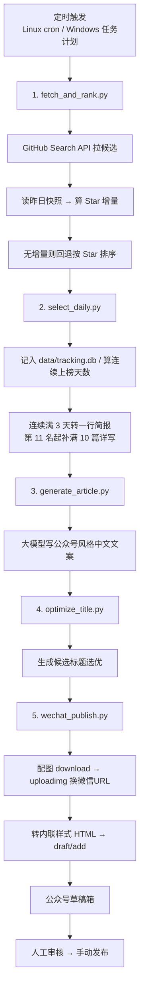

# github-trending-to-wechat

> 每天自动把 GitHub 上的增长热榜，写成一篇中文公众号文章，并送进微信草稿箱。

一条 **零第三方依赖**（只用 Python 标准库）的内容流水线：

```
采集榜单 → 选榜·霸榜判定 → 大模型写文章 → 优化标题 → 建微信草稿
```

## 它是怎么工作的



## 快速开始

```bash
# 1. 配置环境变量（凭证只走环境变量，不落盘）
export GITHUB_TOKEN=ghp_xxx            # 可选：提升 GitHub 限流
export DEEPSEEK_API_KEY=sk-xxx         # 生成文章与标题（任一 OpenAI 兼容 key）
export LLM_BASE_URL=https://api.deepseek.com/v1   # 可选，默认 DeepSeek
export LLM_MODEL=deepseek-chat                     # 可选
export WECHAT_APPID=wx...              # 公众号
export WECHAT_APPSECRET=xxx            # 公众号（需在后台启用 + 加 IP 白名单）
export send_key=xxx                    # 可选：Server酱 sendkey，任一步失败时推送告警

# 2. 跑一遍
python run_daily.py        # 全流程，最后产出公众号草稿
```

Windows PowerShell 里用 `$env:GITHUB_TOKEN="..."`。

## 文件说明

| 文件 | 作用 |
|---|---|
| `fetch_and_rank.py` | 采集候选 + 用快照算 Star 增量，写 `data/daily/` |
| `select_daily.py` | 记榜入库、判定霸榜，产出 `data/daily/<日期>.selected.json` |
| `generate_article.py` | 大模型写文章，输出 `data/articles/` |
| `optimize_title.py` | 候选标题生成与选优 |
| `wechat_publish.py` | 转 HTML + 传图 + 建草稿 |
| `wechat_test.py` | 微信凭证/权限自检（含 `--selftest` 离线自检） |
| `tracking.py` | SQLite 追踪库：上榜记录 + 连续天数 + 深挖队列（stdlib `sqlite3`） |
| `run_daily.py` | 一键编排上面五步 |
| `notify.py` | 失败告警：把失败的步骤和报错推送到 Server酱（零依赖） |
| `netutil.py` | 带退避重试的 HTTP 调用，专治间歇性网络抖动 |
| `feature_article.py` | 单项目深挖：优先消费深挖队列 → 扒 README 图 → 按风格文档写文章 |
| `run_feature.sh` | 深挖的 72 小时时间闸（cron 每 5 分钟调用，满 72h 才真跑） |
| `ARTICLE_STYLE.md` | 「单项目深挖」文章风格约束（AI 生成时引用） |
| `SKILL.md` | 作为 AI Agent Skill 使用的说明 |

## 产出示例

`data/articles/<日期>.md`（详写条目 + 霸榜简报条目）：

````markdown
# 今天 GitHub 上 12 个顶顶顶的开源项目。

**01**

**owner/repo：一句话卖点**

它是什么……
怎么用，比如你可以……
适合谁 / 注意事项。

今日新增约 320 Star。

```
开源地址：https://github.com/owner/repo
```


**04**

**hot/repo：连续霸榜的卖点（连续上榜 4 天）**

今日新增约 120 Star。

```
开源地址：https://github.com/hot/repo
```
````

> 连续上榜满 3 天的项目从**第 4 天起只保留这一行**——不写正文、不配图。空出的篇幅由榜单**第 11 名起往后补**，保证当天仍有 10 篇详写，所以文章总数会变成 `10 + 霸榜数`。

## 已知边界（很重要）

- **首次运行没有增量。** 只有一天快照时按 Star 兜底排序；**第二天起**才是真正的「增长榜」。
- **只建草稿，不自动发表。** `freepublish/submit` 需要账号权限，**个人未认证订阅号会返回 `48001`**。发布由人工在后台完成。
- **数据统计接口同样不可用。** `datacube/*`（文章阅读量、用户分析等）在个人未认证号上同样返回 `48001`，拿不到阅读数据。
- **依赖固定出口 IP。** 运行机器的公网 IP 要在公众号后台白名单里，IP 变了会报 `40164`。
- **大模型文案需人工过目。** 生成的标题/描述建议发布前审一遍。
- **追踪库 `data/tracking.db` 是运行态，不入 git。** 它在被忽略的 `data/` 下，**不随代码部署**——生产那份在运行机器上（当前是 ECS），本地开发机是独立的一份。丢了可以从 `data/articles/` + `data/daily/` 重建：`python tracking.py --backfill`。
- **连续上榜按「实际记录过的天」算。** 日期口径是 UTC；某天流水线没跑**不会**断连，跑过但项目掉出文章才重置为 1。连续满 3 天（第 4 天起）转一行简报，连续满 5 天自动进入深挖队列。
- **深挖队列每 72 小时消费一个**（由 `run_feature.sh` 控时），按连续天数优先、同分先入先出；失败自动回队列，重试 3 次后转 `failed`，可用 `python tracking.py --requeue owner/name` 重开。

## License

MIT
