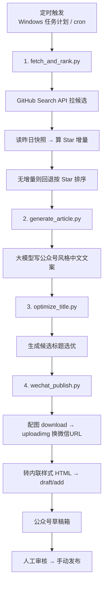

# github-trending-to-wechat

> 每天自动把 GitHub 上的增长热榜，写成一篇中文公众号文章，并送进微信草稿箱。

一条 **零第三方依赖**（只用 Python 标准库）的内容流水线：

```
采集榜单 → 大模型写文章 → 优化标题 → 建微信草稿
```

## 它是怎么工作的



## 快速开始

```bash
# 1. 配置环境变量（凭证只走环境变量，不落盘）
export GITHUB_TOKEN=ghp_xxx            # 可选：提升 GitHub 限流
export DEEPSEEK_API_KEY=sk-xxx         # 生成文章与标题（任一 OpenAI 兼容 key）
export LLM_BASE_URL=https://api.deepseek.com/v1   # 可选，默认 DeepSeek
export LLM_MODEL=deepseek-chat                     # 可选
export WECHAT_APPID=wx...              # 公众号
export WECHAT_APPSECRET=xxx            # 公众号（需在后台启用 + 加 IP 白名单）

# 2. 跑一遍
python run_daily.py        # 全流程，最后产出公众号草稿
```

Windows PowerShell 里用 `$env:GITHUB_TOKEN="..."`。

## 文件说明

| 文件 | 作用 |
|---|---|
| `fetch_and_rank.py` | 采集候选 + 用快照算 Star 增量，写 `data/daily/` |
| `generate_article.py` | 大模型写文章，输出 `data/articles/` |
| `optimize_title.py` | 候选标题生成与选优 |
| `wechat_publish.py` | 转 HTML + 传图 + 建草稿 |
| `wechat_test.py` | 微信凭证/权限自检（含 `--selftest` 离线自检） |
| `run_daily.py` | 一键编排上面四步 |
| `SKILL.md` | 作为 AI Agent Skill 使用的说明 |

## 产出示例

`data/articles/<日期>.md`：

```markdown
# 今天 GitHub 上 10 个顶顶顶的开源项目。

**01**

**owner/repo：一句话卖点**

它是什么……
怎么用，比如你可以……
适合谁 / 注意事项。

今日新增约 320 Star。

```
开源地址：https://github.com/owner/repo
```
```

## 已知边界（很重要）

- **首次运行没有增量。** 只有一天快照时按 Star 兜底排序；**第二天起**才是真正的「增长榜」。
- **只建草稿，不自动发表。** `freepublish/submit` 需要账号权限，**个人未认证订阅号会返回 `48001`**。发布由人工在后台完成。
- **依赖固定出口 IP。** 运行机器的公网 IP 要在公众号后台白名单里，IP 变了会报 `40164`。
- **大模型文案需人工过目。** 生成的标题/描述建议发布前审一遍。

## License

MIT
